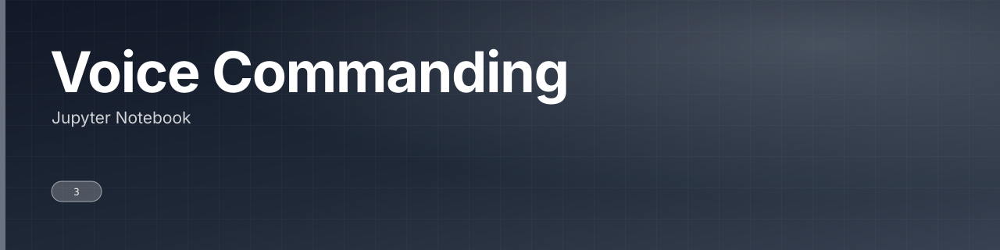

Notebook experimenting with voice-command recognition.

 

 

---

## What this is

A small notebook experimenting with recognising spoken commands. Exploratory, two tracked files.

|  |
|:--:|
| **1** |
| docs |

---

<a href="https://github.com/gowtham-creator/voice-commanding">gowtham-creator/voice-commanding</a>

